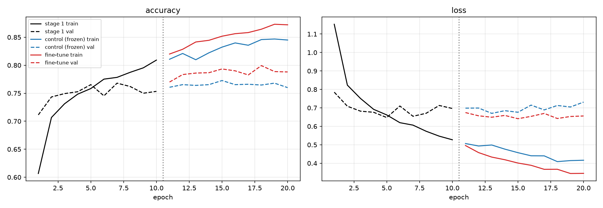
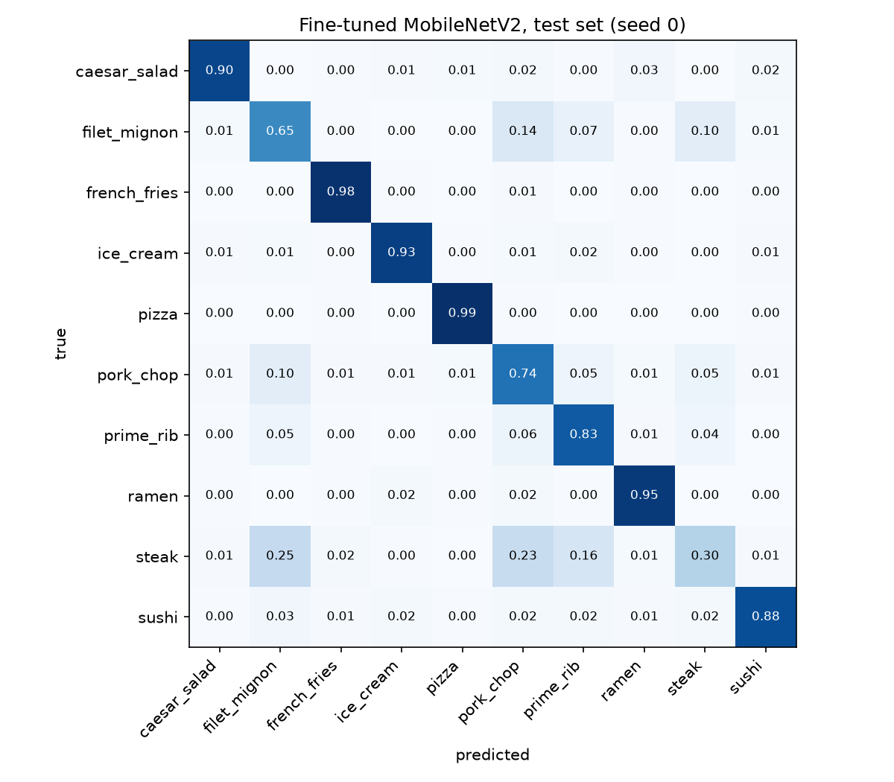
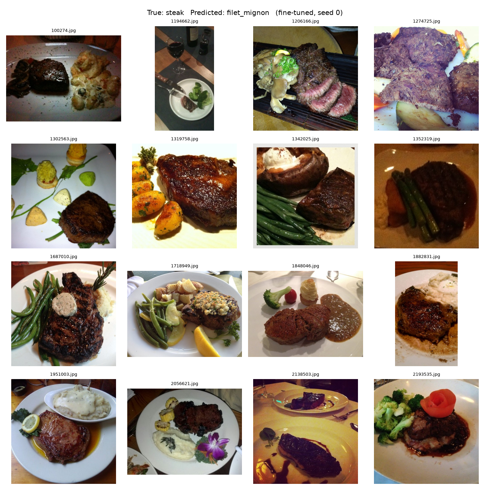

# Transfer Learning on Food-101 with MobileNetV2: Frozen vs. Fine-Tuned, and int8 Deployment

A MobileNetV2 (ImageNet-pretrained) classifier for 10 Food-101 classes, built in TensorFlow/Keras. The project asks three questions:

1. Does fine-tuning the base network beat a frozen base **trained for the same number of epochs**?
2. Where exactly does the model fail, and why?
3. What does int8 quantization cost for on-device deployment?

## Headline results

| | Test accuracy (mean ± std, 3 seeds) |
|---|---|
| Frozen base, 10 epochs | 78.8 ± 0.7% |
| Frozen base, 20 epochs (**control**) | 79.0 ± 0.3% |
| **Fine-tuned top 30 layers, 10 + 10 epochs** | **81.0 ± 0.4%** |

| Deployment (fine-tuned model, seed 0) | Size | Test accuracy | Latency* |
|---|---|---|---|
| TFLite float32 | 9.55 MB | 81.28% | 3.9 ms |
| TFLite dynamic-range | 2.70 MB | 81.64% | 4.7 ms |
| **TFLite full int8** | **2.90 MB** | **81.56%** | **2.6 ms** |

\*Median per image, batch 1, 1 thread, desktop CPU with the XNNPACK delegate. This is not phone latency.

**Key findings**

- **Fine-tuning beats the control on every seed** (+2.5, +1.5, and +1.8 points; mean +1.9). The ranges don't overlap: the worst fine-tuned run (80.56%) beats the best control (79.40%). Training the frozen model 10 more epochs added only +0.2, so the gain comes from adapting the base, not from extra training.
- **About 70% of that gain comes from one class, and it's mostly a decision-boundary shift.** filet_mignon recall rose from 52% to 65%, but its precision barely moved (~52% → ~53%). The fine-tuned model predicts "filet_mignon" 22% more often, largely at steak's expense (see [Error analysis](#error-analysis)).
- **int8 quantization is 3.3× smaller and 1.5× faster than float32, with no measurable accuracy loss.** The +0.3-point difference is about 7 images, which is noise. Dynamic-range quantization shrinks the file but runs *slower*, because weights are converted back to float at runtime. Only full int8 speeds up inference.

## Data

- **Source:** [Food-101](https://data.vision.ee.ethz.ch/cvl/datasets_extra/food-101/) (Bossard et al., 2014), using the **official train/test split**.
- **Classes (10):**
  - **Hard, visually similar meats:** `steak`, `filet_mignon`, `pork_chop`, `prime_rib`. Chosen deliberately, so the confusion matrix has something to reveal.
  - **Easier dishes:** `sushi`, `pizza`, `ice_cream`, `french_fries`, `ramen`, `caesar_salad`.
- **Splits:**
  - **Train:** 6,000 images (80% of the official train split).
  - **Validation:** 1,500 images (the other 20%), using a fixed split seed so it's identical across all runs.
  - **Test:** 2,500 images, the official test split. Never used for training, tuning, or model choice.
- **Label noise:** Food-101's authors deliberately left the **training** labels uncleaned, while the **test** set was manually verified. This is why validation accuracy (~78–79%, carved from noisy train data) runs below test accuracy (~81%).

## Pipeline

- **Model:**
  - Input 224×224
  - Augmentation: `RandomFlip("horizontal")`, `RandomRotation(0.1)`, `RandomZoom(0.1)`
  - `Rescaling(1/127.5, offset=-1)`
  - MobileNetV2 base (`include_top=False`, ImageNet weights)
  - GlobalAveragePooling2D → Dense(128, ReLU) → Dropout(0.3) → Dense(10, softmax)
- **Stage 1:** base frozen, Adam at learning rate 1e-3, 10 epochs.
- **Control:** continues Stage 1 with the base still frozen, 10 more epochs at 1e-3.
- **Fine-tune:** starts from the *same* Stage 1 weights, unfreezes the last 30 base layers, Adam at 1e-5, 10 epochs.
- **Seeds:** 3 per condition (0, 1, 2), all on the identical train/validation split.

Two correctness details that commonly break MobileNetV2 transfer learning:

1. **Input scaling.** MobileNetV2 expects pixels in [-1, 1], not [0, 1] or [0, 255]. The `Rescaling` layer above is equivalent to `mobilenet_v2.preprocess_input`.
2. **BatchNorm during fine-tuning.** In the first run, fine-tuning epoch 1 showed training accuracy dropping from 0.81 to 0.65 even though validation accuracy (0.76) confirmed the Stage 1 weights had loaded correctly. The drop appeared only in training mode, consistent with the unfrozen BatchNorm layers switching to batch statistics. Freezing all BatchNorm layers explicitly fixed it: epoch 1 now starts at ~0.82 on every seed. The fix changed final test accuracy by only +0.2 points, but it removed a real bug.



After ~5 epochs, the frozen model's training accuracy keeps rising while validation stays flat around 76%: the head is overfitting, which is why more frozen epochs don't help. Fine-tuning moves validation accuracy up to ~79%.

## Error analysis



**Per-class test accuracy** (mean of 3 seeds):

| Class | Control (frozen, 20 epochs) | Fine-tuned | Change |
|---|---|---|---|
| steak | 34.3% | 32.3% | −2.0 |
| filet_mignon | 52.0% | 65.3% | **+13.3** |
| pork_chop | 67.2% | 68.3% | +1.1 |
| prime_rib | 81.1% | 80.1% | −0.9 |
| sushi | 86.8% | 87.6% | +0.8 |
| ice_cream | 89.5% | 91.7% | +2.3 |
| caesar_salad | 92.4% | 92.9% | +0.5 |
| ramen | 91.1% | 94.4% | +3.3 |
| pizza | 98.3% | 98.1% | −0.1 |
| french_fries | 97.7% | 98.8% | +1.1 |

**Top confusions** (fine-tuned model, summed over 3 seeds, 750 test images per class): steak → filet_mignon 218, steak → pork_chop 151, pork_chop → filet_mignon 123, steak → prime_rib 105, filet_mignon → pork_chop 105. **All of the top 5 are among the four meat classes.**

**Did fine-tuning learn better features, or just move a boundary?**

| (3 seeds summed) | Control | Fine-tuned |
|---|---|---|
| Predicted as filet_mignon | 755 | 918 |
| Correct filet_mignon predictions (recall) | ~390 (52%) | ~490 (65%) |
| filet_mignon precision | ~52% | ~53% |
| steak → filet_mignon errors | 174 | 218 |
| filet_mignon → steak errors | 107 | 77 |

Better discrimination would have raised precision. Instead, precision is flat while predictions rose 22%, so the fine-tuned model mostly moved the steak/filet_mignon boundary toward "filet_mignon." It still helps overall (+1.9 points, consistent across seeds), but that gain should not be read as broad feature improvement.

**Why steak is so hard (32% accuracy):** filet mignon is itself a cut of steak, and Food-101's `steak` class is a catch-all with uncleaned training labels. Many "errors" are images where both labels are defensible, making this a label-definition problem more than a model failure. A sample of the actual errors:



## Deployment

The fine-tuned model is exported without its augmentation layers (as a SavedModel) and converted to TFLite:

- **float32:** straight conversion.
- **Dynamic-range:** int8 weights, float computation.
- **Full int8:** int8 weights and activations, calibrated on 200 **training** images (never test images), with float input/output.

Each variant is scored on all 2,500 test images using the TFLite interpreter.

- **Conversion is faithful:** TFLite float32 matches the Keras model within 2 images (81.28% vs. 81.36%).
- **The 23.7 MB `.keras` file is not the baseline** because it also stores the optimizer state. The fair size comparison is TFLite float32 (9.55 MB) vs. int8 (2.90 MB).

## Limitations

- **Hyperparameters were not tuned.** Unfreeze depth (30 layers), learning rates, and epoch counts are fixed choices, so the fine-tuning gain is a lower bound, not an optimum.
- **The fine-tuning gain is concentrated** in one ambiguous class pair, as analyzed above.
- **Latency is desktop-CPU latency**, not phone latency. The relative int8 vs. float32 advantage is the transferable part.
- **The export script casts resized images to `uint8`**, which drops sub-integer pixel values. This explains the 2-image gap between the export-time Keras accuracy (81.36%) and the training-time result (81.44%). All deployment variants received identical inputs.
- `tf.lite.Interpreter` is deprecated in favor of the `ai_edge_litert` package in future TensorFlow versions.
- This is a 10-class subset of Food-101, so results don't transfer directly to the full 101-class task.

## Reproduce

```bash
python -m venv .venv && source .venv/bin/activate
pip install "tensorflow[and-cuda]" matplotlib scikit-learn
# if TF doesn't see the GPU, point it to the pip-installed CUDA libraries:
export LD_LIBRARY_PATH=$(python -c "import nvidia, os, glob; print(':'.join(glob.glob(os.path.join(list(nvidia.__path__)[0], '*', 'lib'))))"):$LD_LIBRARY_PATH

wget http://data.vision.ee.ethz.ch/cvl/food-101.tar.gz && tar -xzf food-101.tar.gz
python prep_data.py                         # 10 classes, official split -> data/train, data/test
for s in 0 1 2; do python train.py $s; done # ~8 min/seed on an RTX 3050
python analyze.py                           # seed summary, curves, confusion matrix, per-class table
python inspect_errors.py                    # boundary-shift check + error image grid
python tflite_export.py                     # float32 / dynamic / int8 export + evaluation
```

Outputs are written to `results/` (per-seed histories, test probabilities, and figures) and `results/tflite/`.